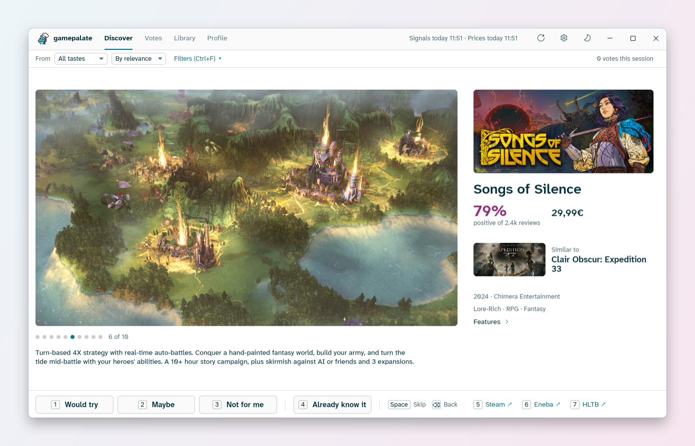
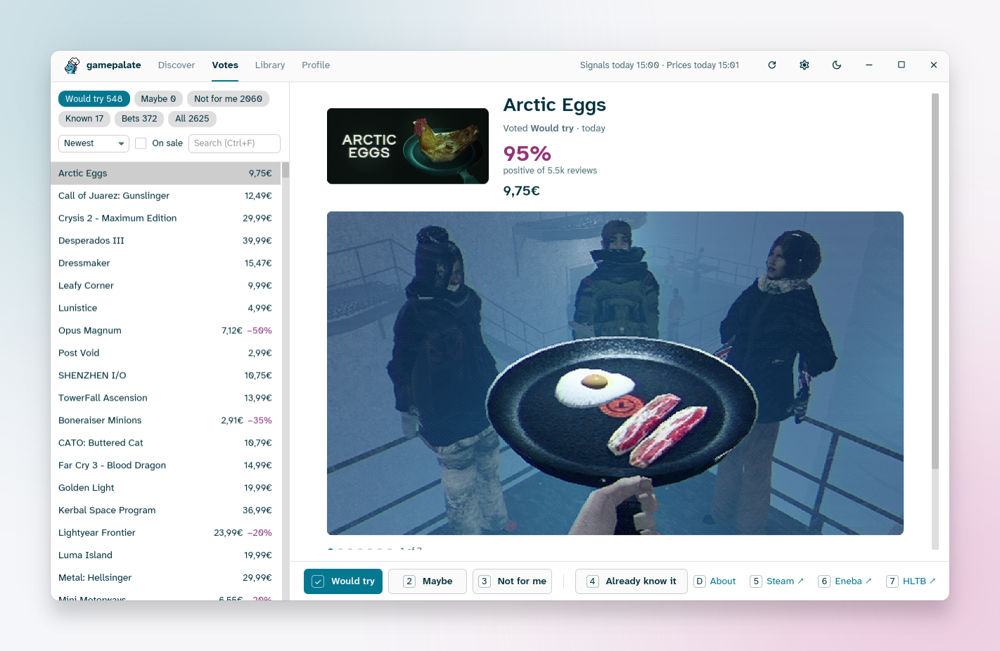
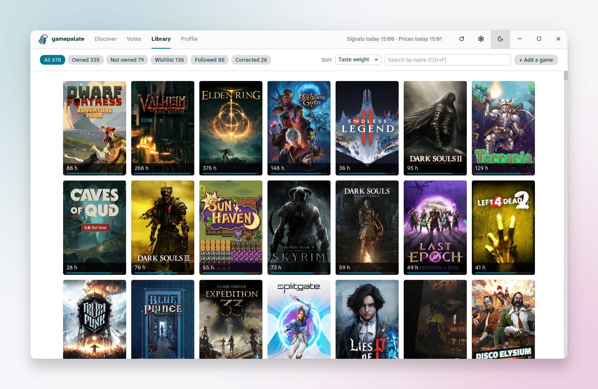
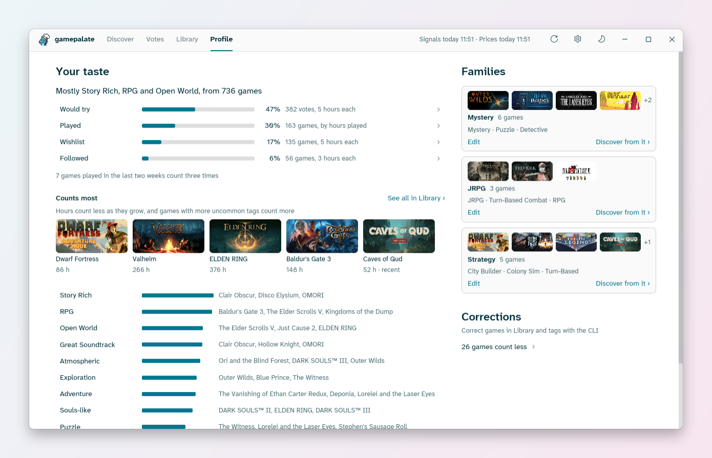

<p align="center"></p>

<h1 align="center">gamepalate</h1>

gamepalate is a Steam game recommender. It builds a tag profile from your library and playtime, then ranks the Steam catalog against it to produce a list of suggestions. You vote on them, and your votes feed back into the ranking.

The recommendation system runs locally. The only network calls go to Steam.

<picture>
  <source media="(prefers-color-scheme: dark)" srcset=".github/screenshots/discover-dark.png">
  
</picture>

## Screens

- **Discover**: recommendations with filtering options
- **Votes**: votes on past recommendations
- **Library**: games list with covers, where you can adjust how each game counts
- **Profile**: top tags and families

<picture>
  <source media="(prefers-color-scheme: dark)" srcset=".github/screenshots/votes-dark.png">
  
</picture>

<picture>
  <source media="(prefers-color-scheme: dark)" srcset=".github/screenshots/library-dark.png">
  
</picture>

<picture>
  <source media="(prefers-color-scheme: dark)" srcset=".github/screenshots/profile-dark.png">
  
</picture>

## Requirements

- Windows 10 or 11 (Linux and macOS are planned)
- A [Steam Web API key](https://steamcommunity.com/dev/apikey)

## Download

Download `gamepalate-setup.exe` from the [latest release](https://github.com/cristian-tentella/gamepalate/releases/latest) and run it. It installs gamepalate for your user only, with no administrator rights, and adds it to the Start menu. Uninstalling keeps your data.

To skip the installer, download `gamepalate.exe` and run it from any folder. `SHA256SUMS.txt` lists the checksums of the files.

The files are not signed yet, so on the first run Windows SmartScreen shows "Windows protected your PC". Click **More info**, then **Run anyway**.

## Data

Data lives in `%APPDATA%\gamepalate` (config, votes, corrections, `catalog.sqlite`). Override with `GAMEPALATE_DATA_DIR`.

The API key is stored in Windows Credential Manager, or read from `STEAM_API_KEY`. Logs go to `logs\gamepalate.log` (API keys and Steam IDs are redacted).

## Build

```
cargo build --release -p gamepalate-gui
```

Output: `target/release/gamepalate.exe`. The first run asks for the API key and your Steam profile, then downloads the catalog (this takes a while).

`gamepalate-cli` covers the same features from the terminal. Build it with `cargo build --release -p gamepalate-cli` and run `gamepalate-cli --help` for the commands.

To build the installer, build both executables, then compile `crates/gamepalate-gui/gamepalate.iss` with [Inno Setup](https://jrsoftware.org/isinfo.php) 6. Output: `target/installer/gamepalate-setup.exe`.

## License

Licensed under either of [MIT](LICENSE-MIT) or [Apache-2.0](LICENSE-APACHE), at your option.

The bundled Atkinson Hyperlegible Next font is under the SIL Open Font License (`crates/gamepalate-gui/fonts`).
